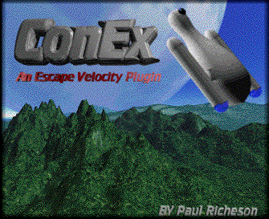
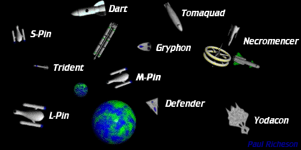
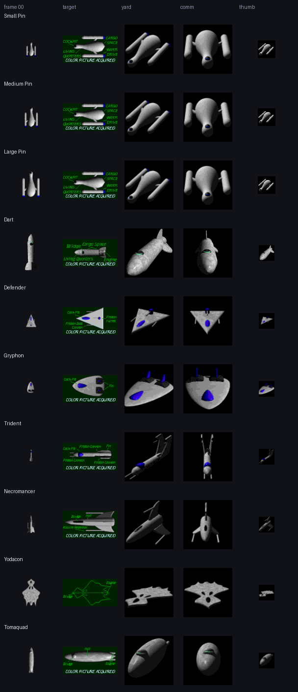

# Yodacon Ship Pack

**Twenty-three starships by Paul Richeson, free for your game, your web page or
your 3D scene, under GPL-2.0-or-later.**

Paul Richeson designed these ships for *ConEx*, his plugin for Ambrosia's
*Escape Velocity*, rendered them in Infini-D, and published them in 1997. A
year later he rebuilt them larger for *ConEx Override*, and two more of his
ships, Advisor and Citrus, first flew in konex in 2005. This pack recovers
every picture of every ship from the original archives, byte for byte, and
hands them to you ready to use: rotation frames with transparency, sprite
sheets, masks, and the targeting, shipyard, comm and icon pictures, with the
ships' own stats and descriptions.

**[Browse the ships](https://yodacon.org/ship-pack/)** ·
**[Fly one](https://yodacon.org/ship-pack/demo/?edition=conex&ship=yodacon)** ·
**[Download](https://github.com/yodacon/yodacon-ship-pack/releases)** ·
[Examples](examples/) · [Playground](playground/) · [Sample projects](projects/) ·
[Timeline](TIMELINE.md) · [Who's using it](USED-IN.md)

<p>


</p>

*ConEx's title picture and fleet, by Paul Richeson, 28 November 1997, from the
ConEx 1.2 readme.*



## Purpose

These ships have been out of reach for most of their life. They lived inside
a Mac resource fork, wrapped in a StuffIt archive, wrapped in BinHex, in an
add-on library whose host is gone. You needed a 1990s Mac to see them, and the
plugin's 1997 terms said no one could pass on a modified copy.

The pack exists to change both things:

- **Anyone can use them.** The author has released them under the GNU General
  Public License, version 2 or later, the same licence as
  [konex](https://github.com/yodacon/konex) and
  [Gonex](https://github.com/yodacon/gonex), the games that already fly them.
  A GPL licence is what lets [yodacon.org](https://yodacon.org/ship-pack/) host
  the pack as a public asset library, and lets you copy, change, sell and
  rehost it, as long as it stays free for the next person.
- **They work where games are made now.** Each ship is plain PNG and JSON,
  laid out the same way, so it drops into a DOM page, a Canvas 2D game,
  three.js, Phaser, PixiJS, or anything else that can draw a picture. A small
  library adds a `<yodacon-ship>` web component, and every example is a
  single page you can copy.
- **The originals stay alive.** The archives are rehosted in
  [`sources/`](sources/), with dated pictures of the catalogue pages that
  listed them and links back to where they were first published.
- **It's rebuildable from first principles.** The extractor that opens the
  archives is in [`tools/`](tools/), in plain Python, and checks every byte.
  Nobody needs a vintage Mac or a closed tool to make the pack again.

## What's in it

| Edition | Year | For | Ships | Sprites |
| --- | --- | --- | --- | --- |
| [**ConEx 1.2**](conex/) | 1997 | *Escape Velocity* | Small Pin, Medium Pin, Large Pin, Dart, Defender, Gryphon, Trident, Necromancer, Yodacon, Tomaquad | 32–80 px |
| [**ConEx Override 1.0**](override/) | 1998 | *EV Override* | Small Pin, Large Pin, Callisto, Dart, Defender, Gryphon, Trident, Necromancer, Yodacon, Tomaquad, 1/4 Defender | 40–104 px |
| [**konex**](konex/) | 2005 | konex | Advisor, Citrus: rendered by Paul Richeson, rehosted from konex with their target, shipyard and comm pictures | 64 px |

Each plugin edition also has every picture in the plugin decoded to PNG, including the landing views (ConEx Override's
are the Bryce renders), and the original readme converted to Markdown. Each
edition's README lists its ships with stats.

One weapon sprite belongs to the pack as a whole: [`weapons/missile-repeater/`](weapons/missile-repeater/),
a stand-in missile for testing. It is a plain line, 16×16, drawn by the builder
and turned 10° per frame, with a mask and an alpha sheet laid out like the ships'.
(The plugins' own Missile Repeater art is not Paul Richeson's, so the pack leaves it out.)

**Planets** too, a first set: [`planets/`](planets/) has five types in three sizes,
generated by `tools/make_planets.py` and lit like the ships, in the same three
forms (picture, opaque, mask) with a radius for gravity and collisions.

### One ship's folder

```text
conex/ships/yodacon/
  frames/00.png … 35.png   rotations, RGBA, transparent background
  sheet-alpha.png          all 36 frames on one 6×6 sheet, RGBA
  sheet.png                the sprite sheet as shipped (RGB, black background)
  mask.png                 its mask as shipped (white = ship)
  target.png               targeting display, 128×64
  yard.png                 shipyard picture, 100×100
  comm.png                 comm portrait, 100×100
  thumb.png                icon, 32–36 px
  ship.json                stats, frame size, description, escort line, source IDs
```

**Rotation.** Frame `00` points nose-up and each frame turns **10° clockwise**:
`frame = floor(heading / 10) mod 36`. On the sheet the frames run left to
right, top to bottom.

**Scaling.** These are 1990s pixels. Scale by whole numbers with
nearest-neighbour filtering (`image-rendering: pixelated`) to keep them sharp.

[`catalog.json`](catalog.json) lists every ship of every edition with its
paths and frame size, for code to load. [`manifest.json`](manifest.json) has a
SHA-256 for every file in the pack.

## Download

| What | Where |
| --- | --- |
| The whole pack, one zip | [Releases](https://github.com/yodacon/yodacon-ship-pack/releases/latest) (`yodacon-ship-pack-2.0.0.zip`), or the tag's source archive: [v2.0.0.zip](https://github.com/yodacon/yodacon-ship-pack/archive/refs/tags/v2.0.0.zip) |
| One edition | the [`conex/`](conex/) or [`override/`](override/) folder |
| One ship | its folder, e.g. [`conex/ships/yodacon/`](conex/ships/yodacon/) |
| The 1990s originals | [`sources/`](sources/README.md): both `.sit.hqx` archives, their expanded `.sit` files and the 1.1 → 1.2 updater |

Every file's SHA-256 is in [`manifest.json`](manifest.json), so you can check a
copy against a release.

## Clone or fork

```sh
# a copy of a fixed version
git clone --branch v2.0.0 https://github.com/yodacon/yodacon-ship-pack

# inside your own repository, pinned to a commit
git submodule add https://github.com/yodacon/yodacon-ship-pack vendor/yodacon-ship-pack
```

**Fork it** on GitHub ([fork](https://github.com/yodacon/yodacon-ship-pack/fork))
to recolour ships, add frames or build your own edition. Keep `LICENSE` and
the credit line, and your fork stays GPL like the original. `make` rebuilds the
assets from `sources/`, and `make test` proves the extractor still reproduces
the 1990s bytes.

## Use it

**Load it from a CDN.** jsDelivr serves any tagged version with CORS enabled:

```html
<script type="module"
  src="https://cdn.jsdelivr.net/gh/yodacon/yodacon-ship-pack@v2.0.0/lib/yodacon-ship-pack.js"></script>
<yodacon-ship ship="yodacon" spin></yodacon-ship>
```

**Link to yodacon.org.** The pack is hosted at
`https://yodacon.org/ship-pack/`, with the same paths as this repository.

**Self-host the showcase.** `index.html` and `demo/` are static pages with
relative links. Serve the folder from anywhere (`make serve` locally) and they
work as they do on yodacon.org.

[`examples/`](examples/) has one small page for each way of drawing the ships:
plain DOM and CSS, Canvas 2D, the web component, three.js, Phaser and PixiJS.
Each is pinned to an exact library version, with notes on how it works and
links to the library's documentation. [`demo/`](demo/) is a small overhead
game: pick any ship and fly it, with its target, comm and shipyard pictures
beside the screen.

[`playground/`](playground/) is a code sandbox in the browser: edit an example
(web component, DOM, Canvas, three.js, Phaser, PixiJS) and run it on the spot,
share it as a link, or open it in CodePen. [`projects/`](projects/) has
complete sample projects to copy: a DOM shipyard, a DOM dogfight, a three.js
fleet flyby and a three.js hangar, and [**Konquest**](projects/konquest/): KDE's
galactic conquest with its exact rules, Easy/Medium/Hard opponents, and the
pack's ships and planets.

The look has a guide: [docs/STYLE.md](docs/STYLE.md), with
`lib/yodacon-style.css` to link and a [specimen page](styleguide/); and
[docs/HOUSE-STYLE.md](docs/HOUSE-STYLE.md) describes the family it shares with
treadcore.org and paulricheson.com.

## The licence, in plain words

© 1997–1998 Paul Richeson. GPL-2.0-or-later; the full text is in
[LICENSE](LICENSE).

- **You can** use the ships in anything, free or paid, change them however you
  like, and host or share them.
- **Credit** Paul Richeson (ConEx) and this pack, where players or readers can
  see it.
- **Keep them free.** If you hand the art to anyone, it goes with this licence
  and the LICENSE file, and your changes to it are GPL too.
- **Your project.** A game that builds the art into itself should be under a
  GPL-compatible licence. The two simple, safe routes are to license your
  project GPL, or to keep the pack as a separate, unmodified, vendored folder
  with its LICENSE beside it, loaded at run time.

This is a summary, not legal advice; the
[GPL FAQ](https://www.gnu.org/licenses/gpl-faq.html) answers most questions.

**Credit line:**

```text
Ships from the Yodacon Ship Pack by Paul Richeson (ConEx, 1997),
GPL-2.0-or-later — https://github.com/yodacon/yodacon-ship-pack
```

## How they were made, 1997–98

In Paul's own words, from the ConEx 1.2 readme: *"The stuff I used to make
this plugin, in order from most important to least important"*:

| Tool | What it was for |
| --- | --- |
| **Infini-D** | "To Design the Ships" |
| **EV-Edit** | "To make every thing except missions" |
| **Schmelta-V** | "To Make missions" |
| **ResEdit** | "To change the Resource numbers so they go in order, and to fix what EV-Edit screwed up" |
| **GraphicConverter** | "To convert all the images to PICT so that EV can read them, and make the target graphics" |
| **Make spïn** | "To gather all the 36 Individual PICT files and make Sprites and Masks" |
| **Iomega Zip Drive** | "To store all the files" |
| **Escape Velocity Data** | "To get the TMPL Resources so I can use ResEdit" |
| **Escape Velocity** | "To test out the plugin" |
| **DOCMaker** | "To make this nifty Readme File" |
| **Bryce 2** | "To make the screen at ConEx" |

So each ship was modelled and lit in Infini-D and rendered at 36 headings, ten
degrees apart. Make spïn tiled the 36 renders into one sprite sheet and one
mask, which is why every sheet here is a 6×6 grid. GraphicConverter turned
the renders into PICTs and drew the green wireframe target pictures, and EV-Edit
and ResEdit put everything into the plugin's resource fork. Bryce made the
ConEx landing screen in 1997; ConEx Override's catalogue entry says its twelve
new landing pictures were "rendered in Bryce" too.

Both readmes are in the pack, converted from DOCMaker with their pictures:
[ConEx 1.2](conex/readme/README.md) (credits, the ship pages, the story of
Consolidated Express) and [ConEx Override 1.0](override/readme/README.md)
(a spec card and render for every ship).

## How the pack is made, 2026

```text
sources/*.sit.hqx ── binhex.py ──▶ .sit ── stuffit.py ─┬─ arsenic.py (StuffIt 5, method 15)
                                                       └─ sit13.py   (classic, method 13)
      ──▶ resource forks ── rfork.py + tmpl.py ──▶ shïp, spïn, dësc, PICT …
      ──▶ pict.py ──▶ PNG ── build_pack.py ──▶ conex/ override/ catalog.json manifest.json
```

Everything is plain Python with Pillow, in [`tools/`](tools/):

| Tool | Does |
| --- | --- |
| `extract.py` | the command-line extractor: `.hqx` or `.sit` in, forks, resources and PNGs out |
| `binhex.py` | BinHex 4.0, with its three CRC-16 checks |
| `stuffit.py` | StuffIt archives, classic (1.5–4) and 5, with fork CRCs |
| `arsenic.py` | StuffIt 5 "Arsenic": arithmetic coding, move-to-front, Burrows–Wheeler, CRC-32 |
| `sit13.py` | StuffIt method 13: LZ77 with Huffman codes |
| `rfork.py`, `tmpl.py` | Mac resource forks, read and written byte-identically; records decoded by the plugin's own `TMPL`s |
| `pict.py` | QuickDraw PICT: packed bitmaps and pixmaps, 16-bit direct colour, QuickTime JPEG |
| `build_pack.py` | builds all three editions, `catalog.json`, `manifest.json` and the release zip |
| `catalogue.py`, `capture_page.mjs`, `stamp_capture.py` | the catalogue rows and their dated screenshots |

Every layer is checked. The ConEx 1.2 resource fork was first compared,
resource by resource, with an extraction made with The Unarchiver: all 758
resources matched byte for byte. Every ConEx Override fork passes its stored
CRC. `make test` repeats the checks, and `make` rebuilds the whole pack from
`sources/` in about half a minute.

## Where they came from

The full story, dated from the files themselves (ConEx 1.2's plugin was
created on 9 November 1997), is in [TIMELINE.md](TIMELINE.md).

| Year | | By | What happened to the ships |
| --- | --- | --- | --- |
| 1997 | **ConEx 1.2** | Paul Richeson | Designed, rendered and published in an *Escape Velocity* plugin |
| 1998 | **ConEx Override 1.0** | Paul Richeson | Rebuilt at larger sizes for *EV Override*; the Callisto joins, the Medium Pin leaves |
| 1998 | **ConEx GL** | Joshua Bussdieker | The first standalone ConEx, in C and OpenGL, kept in a private repository; no code survives in public |
| 2005 | **[konex](https://github.com/yodacon/konex)** | Joshua Bussdieker | A standalone C++/OpenGL remake whose cast is ConEx Override's ten ships, plus Advisor and Citrus, two more ships Paul Richeson rendered for it |
| 2026 | **[Gonex](https://github.com/yodacon/gonex)** | Team Yodacon | A Go port of konex that restores ConEx's game, and flies the 1997 originals beside konex's |
| 2026 | **Yodacon Ship Pack** | Paul Richeson and Team Yodacon | This: every picture, recovered, documented and free |

Each `ship.json` names the matching konex and Gonex folders under `also_in`.
The pack is part of [Yodacon](https://github.com/yodacon/yodacon), the ConEx
revival, which hosts it at [yodacon.org/ship-pack](https://yodacon.org/ship-pack/).

The original archives, their catalogue entries and links back to Cythera
Guides and Ambrosia Software are in [`sources/`](sources/README.md).
*Escape Velocity* and *EV Override* are Ambrosia Software's. The pack holds
only Paul Richeson's work; the Ambrosia logo the plugins carried is left out.

## Who's flying them

[USED-IN.md](USED-IN.md) ranks every project known to use the pack by how many
ships it flies. To get yours listed, open an issue with the
**"Used in: list my project"** form; [CONTRIBUTING.md](CONTRIBUTING.md) has the
steps.

## Rebuilding

```sh
make test       # the extractor against the original bytes
make            # rebuild conex/ and override/ from sources/
make check      # load every page in headless Chromium, fail on any error
make release    # dist/yodacon-ship-pack-<version>.zip
```

Python 3.10+ with Pillow; Node 22+ and Chromium for the page checks and
screenshots.

## Author

**Paul Richeson** designed and published ConEx in 1997 and ConEx Override in
1998, and released them as this pack in 2026. [paulricheson.com](https://paulricheson.com)
