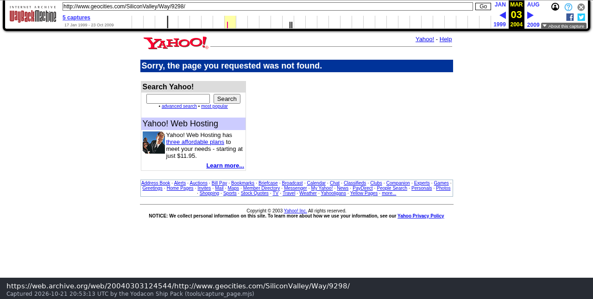
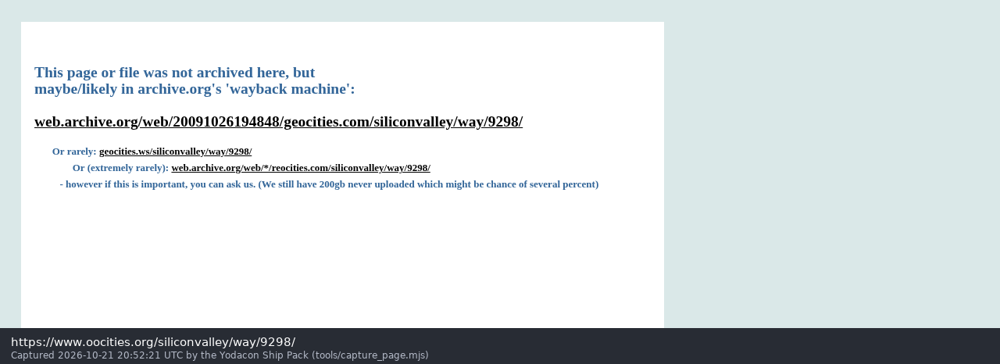

# ConEx: a timeline

From a starship rendered in an Alaskan portable classroom to a free asset pack,
with every date taken from the files themselves or from a dated archive.

**When was ConEx made? 1997.** The oldest timestamp in any surviving file is
the ConEx 1.2 plugin's creation date, **Sunday 9 November 1997**, and ConEx 1.1
came before it. The "1999" seen in add-on catalogues is when Ambrosia's add-on
database listed the files, not when they were made.

Times are as the Mac's clock showed them. Classic Mac OS stored local time
with no time zone, and the StuffIt archives keep those values. (The Unarchiver
displays them an hour earlier, after a time-zone conversion; the stored values
are the ones below.)

---

## Before ConEx

**1996: *Escape Velocity*.** Ambrosia Software's space trading game for the
Macintosh. Its data lives in resource forks, and players can add ships,
systems and missions with plugins.

**The Yodacon.** As Paul Richeson tells it on [paulricheson.com](https://paulricheson.com):
*"In an Alaskan middle school with more children than classrooms, the overflow
kids were taught in portables parked in the snow. Told to name their home
rooms, one of them rendered an actual starship in Infini-D: the Yodacon. The
teachers' vote made it Taurus. The Yodacons lost, but the ship got built, and
it was published in ConEx."*

## 1997: ConEx

**ConEx 1.0 and 1.1** (1997, before November). Their files haven't survived,
but they existed: the 1.2 updater patches ConEx 1.1 into 1.2, and its
catalogue entry says "if you don't already have ConEx1.1, download the
complete ConEx 1.2 package".

| When | What | Evidence |
| --- | --- | --- |
| **Sun 9 Nov 1997, 16:32:18** | The `ConEx1.2` plugin file is created: the oldest date in any ConEx file | StuffIt 5 entry, creation date |
| Thu 27 Nov 1997, 13:04:17 | The `ConEx 1.2` folder that will be archived is created | StuffIt 5 folder entry |
| **Fri 28 Nov 1997, 21:05:34** | Last save of the plugin. Version record: *"ConEx 1.2 ©1997 Paul Richeson, All rights reserved."* | file modification date; `vers` 1 |
| 28 Nov, 21:13–21:15 | The readme, a DOCMaker document, is written and saved: *"ConEx ReadMe 1.2 © 1997, Paul Richeson"* | entry dates; `vers` 1 |
| 28 Nov, 21:18 | The readme's 1.1 → 1.2 patch is made with ResCompare 5.0 | updater archive |
| 28 Nov, 21:49–21:54 | The plugin's 1.1 → 1.2 patch | updater archive |
| 28 Nov, 21:55 | The patches are folded into `ConEx 1.2 Patches` and archived | updater folder entry |

The 1.2 readme gives the address of ConEx's home page and the author's mail:

- `http://www.geocities.com/SiliconValley/Way/9298`
- `conex@geocities.com`

It lists the tools Paul used, from Infini-D for the ships to Bryce 2 for the
landing screen (see [README.md](README.md#how-they-were-made-199798)), and
names five beta testers.

## 1998: ConEx Override

A rebuild for *Escape Velocity Override*. The catalogue entry calls it
"a major change since the original. I started all over again to make it
better."

| When | What | Evidence |
| --- | --- | --- |
| **Tue 26 May 1998, 18:24:00** | The `ConEx Override 1.0` plugin file is created | classic StuffIt entry, creation date |
| **Fri 10 Jul 1998, 22:09:27** | Last save of the plugin. Version record: *"ConEx Override version 1.0.0 / Paul Richeson, North Wind © / conex@geocities.com"* | modification date; `vers` 128 |
| 10 Jul 1998, 22:24 | The `ConEx Override1.0.0` folder is created | folder entry |
| 10 Jul 1998, 23:09 | The readme is saved. It reads *"7/10/97 Version 1.0 is releaced"*: the day and month match the files, so the year is almost certainly a slip for 98 | entry dates; `TEXT` 129 |
| 10 Jul 1998, 23:11 | The folder is archived | folder entry |
| **26 Sep 1998** | ConEx Override listed in Ambrosia's EV Override add-on library, ID 2437 | catalogue date (Cythera mirror) |

Its eleven ships are rebuilt at larger sizes; the Callisto is new, the Medium
Pin is gone, and there are new landing pictures rendered in Bryce.

## 1999–2015: the web moves on

| When | What | Evidence |
| --- | --- | --- |
| 17 Jan 1999 | The Wayback Machine's first capture of the Geocities address: a redirect | Wayback Machine |
| 4 Dec 1999 | ConEx 1.2 (ID 792) and its updater (ID 793) listed in Ambrosia's EV add-on library. 63 of the EV add-ons numbered 700–900 carry this same date, the mark of a bulk import into a new database rather than of new uploads | catalogue dates (Cythera mirror) |
| 31 May 2000 | Ambrosia's EV add-on library, as archived | [Wayback](https://web.archive.org/web/20000531134400/http://www.ambrosiasw.com/games/ev/addons.html) |
| **3 Mar 2004** | `geocities.com/SiliconValley/Way/9298/` is gone: Geocities answers *"Sorry, the page you requested was not found."* The home page was not saved | [Wayback](https://web.archive.org/web/20040303124544/http://www.geocities.com/SiliconValley/Way/9298/) |
| Oct 2009 | Yahoo closes GeoCities. The rescue mirror OoCities has no copy of the page either: *"This page or file was not archived here"* | [OoCities](https://www.oocities.org/siliconvalley/way/9298/) |
| 13 Apr 2013 | Ambrosia's own `ConEx12.sit.hqx` archived. Its SHA-1 matches the file rehosted in this pack, byte for byte | [Wayback](https://web.archive.org/web/20130413003920/http://www.ambrosiasw.com/assets/files/addons/ev/ConEx12.sit.hqx) |
| 12 Feb 2015 | Last capture of Ambrosia's ConEx download | Wayback Machine |

Ambrosia's add-on servers are now offline. The files survive in Cythera
Guides' mirror of Ambrosia's add-on archive
([EV](http://www.cytheraguides.com/archives/ambrosia_addons/ev/),
[EV Override](http://www.cytheraguides.com/archives/ambrosia_addons/evo/)).

## Clones and forks

| When | What | By |
| --- | --- | --- |
| **1998** | **ConEx GL**: the first standalone ConEx, a C and OpenGL program kept in a private repository, written before konex. No code or archive of it is public | Joshua Bussdieker |
| **19 Jul – 31 Aug 2005** | **konex**: a standalone C++/OpenGL remake of ConEx, kept in CVS on 2nd-gen.net (712 file entries in that range). Its cast is ConEx Override's ten ships, plus Advisor and Citrus, two more ships rendered by Paul Richeson | Joshua Bussdieker |
| 3 Oct 2023 | konex brought into git from an old backup; now [yodacon/konex](https://github.com/yodacon/konex) | |
| **27 Aug 2026** | **Yodacon** begins: the ConEx 1.2 archive is found again, expanded and its 538 resources dumped and rebuilt byte for byte ([yodacon/yodacon](https://github.com/yodacon/yodacon)) | Team Yodacon |
| 27 Aug 2026 | **Gonex**: a Go and Ebitengine port of konex that restores ConEx's game, flying the 1997 originals beside konex's cast ([yodacon/gonex](https://github.com/yodacon/gonex)) | Team Yodacon |

## Now: the ship files, as a package

**21 October 2026: the Yodacon Ship Pack.** Paul Richeson releases the ships
of both plugins, and in 2.0.0 his Advisor and Citrus from konex, under
GPL-2.0-or-later, so anyone can use them. The pack
rehosts the original archives, recovers every picture from them with its own
extractor, decodes nine pictures that earlier tools had shown as black, and
adds the readmes, a web component, examples for the DOM, Canvas, three.js,
Phaser and PixiJS, and a demo game. It is at
[yodacon.org/ship-pack](https://yodacon.org/ship-pack/) and
[github.com/yodacon/yodacon-ship-pack](https://github.com/yodacon/yodacon-ship-pack).

Twenty-nine years after the plugin file was created, the ships are free.

---

*Sources: the archives in [`sources/`](sources/README.md) (StuffIt entry
dates and `vers` resources, read with `tools/extract.py`); the catalogue rows
in `sources/catalogue.json`; the Wayback Machine's capture index; the konex
CVS metadata in `yodacon/vendor/konex`; and the repositories' histories.*
