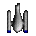
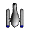
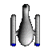
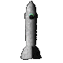
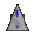
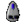
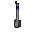
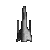
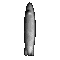

# ConEx 1.2 (1997) — Escape Velocity

10 ships, 1 weapon sprite, 91 pictures and the
original readme (14 chapters), from `sources/ev/792_ConEx12.sit.hqx`.

| Ship | Frame 00 | Sprite | Speed | Shield | Armor | Cargo | Price |
| --- | :---: | ---: | ---: | ---: | ---: | ---: | ---: |
| [Small Pin](ships/small-pin/) |  | 36×36 | 275 | 540 | 300 | 60 | 200,000 |
| [Medium Pin](ships/medium-pin/) |  | 50×50 | 275 | 1,080 | 900 | 180 | 2,000,000 |
| [Large Pin](ships/large-pin/) |  | 65×65 | 250 | 2,160 | 1,800 | 540 | 133,000,000 |
| [Dart](ships/dart/) |  | 80×80 | 350 | 150 | 400 | 1,000 | 1,000,000 |
| [Defender](ships/defender/) |  | 36×36 | 450 | 200 | 100 | 0 | 200,000 |
| [Gryphon](ships/gryphon/) |  | 32×32 | 400 | 400 | 200 | 0 | 50,000 |
| [Trident](ships/trident/) |  | 35×35 | 250 | 250 | 100 | 0 | 900,000 |
| [Necromancer](ships/necromancer/) |  | 50×50 | 225 | 800 | 250 | 80 | 3,000,000 |
| [Yodacon](ships/yodacon/) |  | 70×70 | 300 | 2,000 | 500 | 50 | 2,800,000 |
| [Tomaquad](ships/tomaquad/) |  | 60×60 | 150 | 300 | 200 | 20 | 500,000 |

The numbers are the plugin's own ship records (`shïp`); each `ship.json` has
every field, the shipyard description and the escort pitch.

- [`ships/`](ships/): one folder per ship, as described in the pack's README
- [`weapons/`](weapons/): A-75 Missile Repeater
- [`pictures/`](pictures/): every picture in the plugin, named by resource ID —
  sprite sheets and masks, targets, shipyards, comms, icons and landing views
- [`readme/`](readme/README.md): Paul Richeson's readme, converted to Markdown

Held back from `pictures/`:
- PICT 8100: Ambrosia Software's logo, Ambrosia's trademark, not ConEx art.
