# ConEx 1.2 — the original readme

Paul Richeson's own documentation for ConEx 1.2, as it shipped inside the archive (a DOCMaker document, `ConEx Readme 1.2`, last saved 28 November 1997). Text and pictures are converted as they are, 1990s spelling included. Each chapter's pictures stand at its head; DOCMaker floated them beside the text.

## ConEx

http://www.geocities.com/SiliconValley/Way/9298  
  
Credits  
Creator:  
Paul Richeson  
E-Mail:  
conex@geocities.com  
Beta Testers:  
Ryan             rpierce@ptialaska.net  
David     goldragonne@earthlink.net  
Jesse               rpbrun@televar.com  
John       john@wibbble.demon.co.uk  
Daniel  research_labs@hotmail.com  
I Am Looking For New Beta Testers, Please E-Mail me about it.d li

## New Things Added

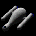

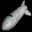

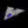

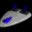

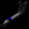

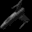

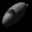

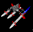

New Things Added  
Ships  
S-Pin, M-Pin, L-Pin  
Dart  
Defender  
Gryphon  
Trident  
Necromencer  
Yodacon  
Tomaquad  
Weapons  
Missile Repeater  
Missions  
35 All New Missions  
Uses Resources150-185  
Planets  
Exeon, Conex, Cenron  
Graphics  
Do to space limitations, I will not show the pictures here, But you can stop at the plants in the Systems ConEx, and Exeon.

## S-Pin

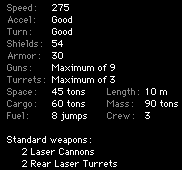

ConEx S-Pin  
The Small Pin is three times a Shuttlecraft in almost every way, and very easy to mass produce. Consolidated Express made this ship because they needed a ship that could outrun pirates, and still carry a reasonable amount of cargo.

## M-Pin

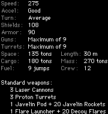

ConEx M-Pin  
The Medium Pin is 3 times the Small Pin in almost every way. This ship is also easy to mass produce. It was made because Consolidated Express noticed how popular the Small Pin was, and the Small Pin didn't carry enough cargo for the bigger shipments.

## L-Pin

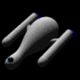

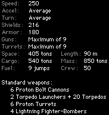

ConEx L-Pin  
The large Pin is the most massive courier ship in the galaxy. It was made by Consolidated Express because the Small and the Medium Pin made huge profits.

## Dart

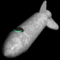

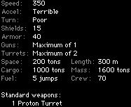

ConEx Dart  
The ConEx Dart is the most massive ship ever built. The design for it is a couple centuries old. But when ConEx put it out on the market, people where crazy to buy it. Its turning are a little above the bulk freighter, and the acceleration is terrible. But the Dart has one unique feature, is has a top speed the same as the Confederate Patrol Ship.

## Defender

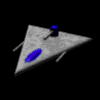

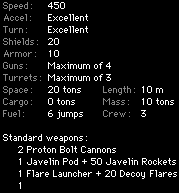

ConEx Defender  
The ConEx Defender is mainly used as fighters for the Large Pin. There have been some that have been known to use this ship to fight against the confederation, alone. None have lived to tell a story. This ship is only powerful in numbers.

## Gryphon

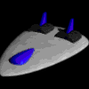

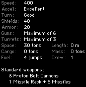

ConEx Gryphon  
This Fast but little ship has little fire power, but  almost indestructible.

## Trident

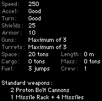

ConEx Trident  
This ship is a little less powerful than the Confed. Patrol ship.

## Necromencer

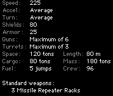

ConEx Necromencer  
The Necromancer is a highly experimental government project. It is Equipped with Three A-75 Missile Repeaters. The weapon is mounted on top of your ships power cells.  Using the E=MC2 principle it converts your ships power to Consolidated Arms Mk. 83 guided missile.

## Yodacon

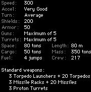

ConEx Yodacon  
The shape of this ship makes it one of  the hardest ships in history to mass produce.  When the plans where showed to High Command they immediately stared building it, for they though the galaxy needed a totally unique design.

## Tomaquad

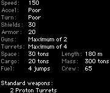

ConEx Tomaquad  
The Tomaquad is ConEx's version of the Luxury Liner.

## About

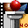

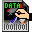

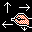

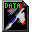

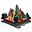

Consolidated Express  
An Escape Velocity Plugin  
By: Paul Richeson  
conex@geocities.com  
ConEx is property of Paul Richeson. Any reproduction of this material is Ok as long as this read-me is included. Do not distribute modified versions of this plugin.  You can place this plugin on public domain or any other public server as long as you e-mail me, telling who you are, who you work for, and what is the purpose. If you are a magazine company, or a company that sells CDs for a profit, do the same as it is for public domain.  
The stuff I used to make this plugin  
inorder from most important to least important  
Infini-D  
To Design the Ships  
EV-Edit  
To make every thing except missions  
Schmelta-V  
To Make missions  
ResEdit  
To change the Resource numbers so they go in order, and to fix what EV-Edit  screwed up.  
Graphic Converter  
To convert all the images to PICT so that EV can read them, and make the target graphics.  
Make spïn  
To gather all the 36 Individual PICT files and make Sprites and Masks.  
Iomega Zip Dirve  
To store all the  files  
Escape Velocity Data  
To get the TMPL Resources so I can use ResEdit.  
Escape Velocity  
To test out the plugin  
DOCMaker  
To make this nifty Readme File  
Bryce 2  
To make the screen at ConEx

## Story

During the great war...  
The confederation needed military shipments...  
That's where Consolidated Express came in...  
ConEx grew incredibly large, and bought Levo for a Head Quoters and named the Planet "ConEx" in the "ConEx" system (used to be Levo system)...  
With ConEx's HQ in the center of the Galaxy it made even more profits than during the Great war...  
Now ConEx is recruiting more people so they can withstand all the shipments...  
Will you Join?
