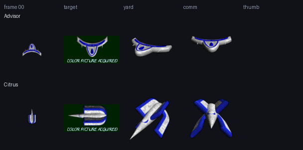

# konex (2005): Advisor and Citrus

Two more ships rendered by Paul Richeson, first published as part of konex,
Joshua Bussdieker's C++/OpenGL remake of ConEx. They were never in a plugin;
konex kept them as 36 rotation frames each, with target, shipyard and comm
pictures, from `sources/konex/` (rehosted from
[yodacon/konex](https://github.com/yodacon/konex), `dist/data/ships/`, CVS
revision 1.3 of 9 August 2005).

| Ship | Frame 00 | Frame | Max velocity | Turn speed | Acceleration |
| --- | :---: | ---: | ---: | ---: | ---: |
| [Advisor](ships/advisor/) |  | 64×64 | 1000 | 220 | 900 |
| [Citrus](ships/citrus/) |  | 64×64 | 1000 | 280 | 800 |

The stats are konex's own (`specs.xml`), not Escape Velocity's. Frames are
konex's 64×64 power-of-two textures, in the same rotation order as the
plugins' ships; there are no icons.
