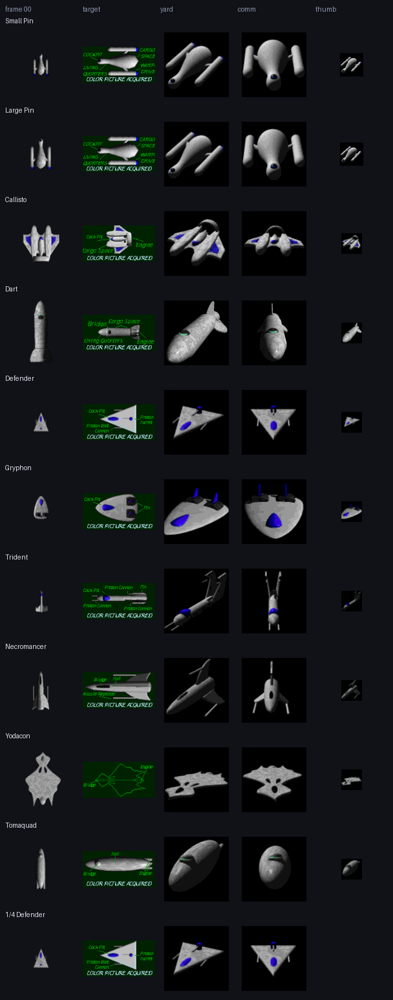
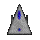
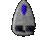

# ConEx Override 1.0 (1998) — Escape Velocity Override

11 ships, 83 pictures and the
original readme (12 chapters), from `sources/evo/2437_ConExOverride.sit.hqx`.

| Ship | Frame 00 | Sprite | Speed | Shield | Armor | Cargo | Price |
| --- | :---: | ---: | ---: | ---: | ---: | ---: | ---: |
| [Small Pin](ships/small-pin/) |  | 40×40 | 275 | 100 | 80 | 60 | 30,000 |
| [Large Pin](ships/large-pin/) |  | 56×56 | 300 | 200 | 100 | 180 | 200,000 |
| [Callisto](ships/callisto/) |  | 72×72 | 250 | 300 | 200 | 150 | 10,000,000 |
| [Dart](ships/dart/) |  | 104×104 | 400 | 300 | 1,000 | 1,000 | 700,000 |
| [Defender](ships/defender/) |  | 40×40 | 450 | 100 | 50 | 5 | 500,000 |
| [Gryphon](ships/gryphon/) |  | 48×48 | 400 | 300 | 75 | 20 | 2,000,000 |
| [Trident](ships/trident/) |  | 40×40 | 300 | 350 | 50 | 1 | 50,000 |
| [Necromancer](ships/necromancer/) |  | 72×72 | 225 | 500 | 100 | 50 | 29,000,000 |
| [Yodacon](ships/yodacon/) |  | 96×96 | 100 | 750 | 1,500 | 150 | 15,000,000 |
| [Tomaquad](ships/tomaquad/) |  | 72×72 | 250 | 30 | 20 | 100 | 750,000 |
| [1/4 Defender](ships/quarter-defender/) |  | 40×40 | 450 | 100 | 50 | 5 | 0 |

The numbers are the plugin's own ship records (`shïp`); each `ship.json` has
every field, the shipyard description and the escort pitch.

- [`ships/`](ships/): one folder per ship, as described in the pack's README
- [`pictures/`](pictures/): every picture in the plugin, named by resource ID —
  sprite sheets and masks, targets, shipyards, comms, icons and landing views
- [`readme/`](readme/README.md): Paul Richeson's readme, converted to Markdown
