# ConEx Override 1.0 — the original readme

Paul Richeson's own documentation for ConEx Override 1.0, as it shipped inside the archive (a DOCMaker document, `ConEx Readme 1.0`, last saved 10 July 1998). Text and pictures are converted as they are, 1990s spelling included. Each chapter's pictures stand at its head; DOCMaker floated them beside the text.

## Welcome

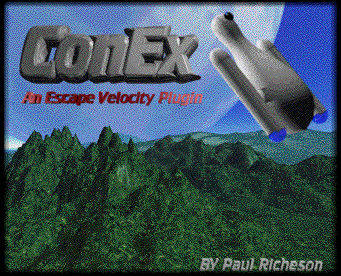

ConEx is property of Paul Richeson. Any reproduction of this material is Ok as long as this read-me is included. Do not distribute modified versions of this plugin.  You can place this plugin on public domain or any other public server as long as you e-mail me, telling who you are, who you work for, and what is the purpose. If you are a magazine company, or a company that sells CDs for a profit, do the same as it is for public domain.  
Credits  
Creator:  
Paul Richeson  
E-Mail:  
conex@geocities.com

## Updates / Bug

----------  
7/10/97  
Version 1.0 is releaced  
Still haven't worked out all the bugs, but it is still usable. Hopfully next version will be easier for the beginer to understand.

## S-Pin

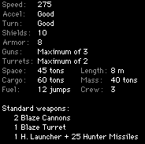

ConEx Small Pin  
The Small Pin is three times a Shuttlecraft in almost every way. Consolidated Express designed this ship to out run attacking ships, while makeing a design that is easy to mass produce.

## L-Pin

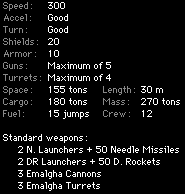

ConEx Large Pin  
The Consolidated Express Large Pin

## Callisto

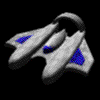

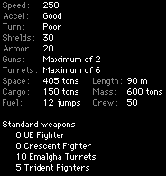

ConEx Callisto

## Dart

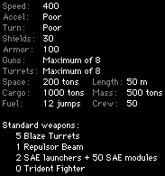

ConEx Dart  
The Consolidated Express Dart Freighter is the most massive ship ever built. The design was designed at the end of the 21st century. But when ConEx put the ship out on the market, there was a high demand. The Dart Freighter's best defence is that it can out run most ships, the only problem it is terrable accelaterion.

## Defender

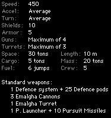

ConEx Defender  
The Consolidated Express Defender is a week combate ship. Made for those daring young souls who want to fight, this is the ship for them.

## Gryphon

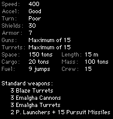

ConEx Gryphon  
The Consolidated Express Gryphon was originally designed as a carried fighter ship. Until the administration noticed that it was a very sturdy ship. Then they enlarged the ship by a factor of 3. Which now holds a crew of 25, no 2 as the original.

## Trident

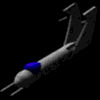

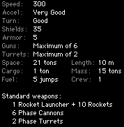

ConEx Trident  
The Consolidated Express Trident Fighter was designed as a fighter ship for the ConEx shiping Company. This tiny little ship is will match with the UE Fighter.

## Necromancer

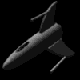

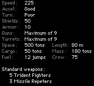

ConEx Necromancer  
The Necromancer is a highly classified experimental government project. It is Equipped with Three  Consolidated Arms Multi Phase Dimension Missile Repeaters (CAMPDeMR). The weapon is mounted on top of your ships massive power cells. It converts your ships energy into Consolidated Arms Multi Phase Dimension Mk. 83 smart guided missile.

## Yodacon

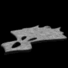

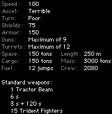

ConEx Yodacon  
The Consolidated Express Yodacon is the Biggest/Baddest ship of the ConEx fleet. This escort ship carries 15 tridents that are stored in 5 launch bays, for fast launching.

## Tomaquad

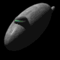

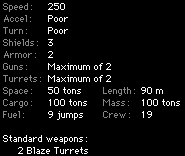

ConEx Tomaquad  
The Consolidated Express Tomaquad Luxury Liner is a transport ship for large shipments. Most commonly used to trade commodity exchange.
