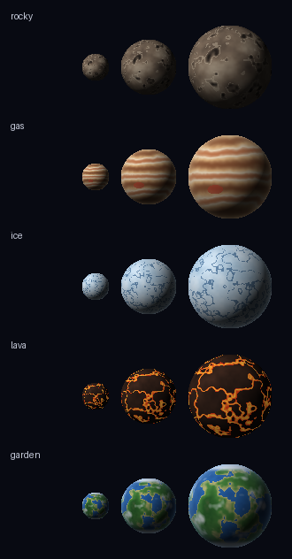

# Planets (generated)

A starting set of planets for games that need them: five types, three sizes
each (small 32 px, medium 64 px, large 96 px), drawn by
`tools/make_planets.py`. They are generated, not rendered: the plugins'
own planet sprites belong to Escape Velocity, so the pack makes its own until
hand-rendered planets replace them.

| Type | Look |
| --- | --- |
| `rocky` | a cratered rocky world |
| `gas` | a banded gas giant |
| `ice` | a cracked ice world |
| `lava` | a dark crust over glowing lava |
| `garden` | oceans, land, ice caps and cloud |

Each `planets/<type>/<size>/` folder has `planet.png` (RGBA), `opaque.png`
(RGB on black), `mask.png` (white where the planet is) and `planet.json`
(diameter, radius, light direction), the same three forms the ships come in.
Light comes from the upper left, as on the ships; the larger sizes are the
same planet with more detail, not a different one.
