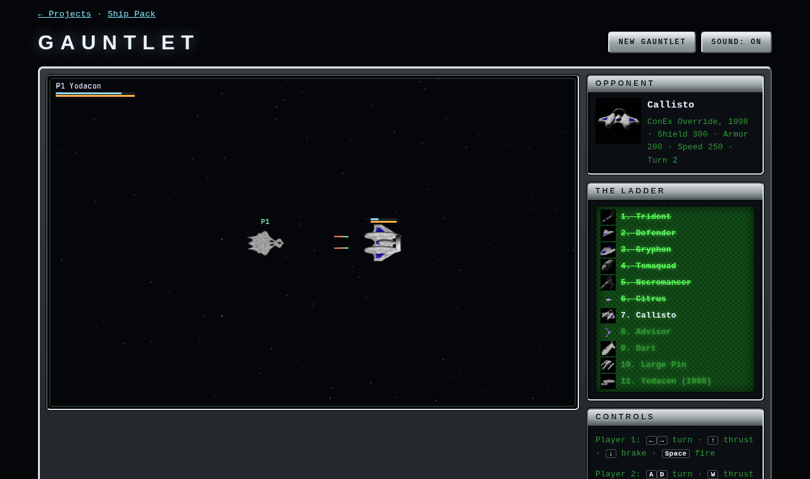

# Gauntlet

Pick any of the pack's thirteen designs and fight the others, one round each,
weakest first. Then come the 1998 Yodacon from ConEx Override, and after it
one more round, the **Override Wing**: three 1998 re-renders flying together,
a Dart leading a Defender and a Tomaquad. One or two players, on the keyboard,
gamepads or the touch pad.

| | |
| --- | --- |
| Technique | Canvas 2D, a fixed 60 Hz step, the Gamepad API (standard mapping), Web Audio through `lib/yodacon-sound.js` |
| Ships | all thirteen designs: ConEx's ten, Override's Callisto, konex's Advisor and Citrus; then the Override Yodacon, and the Override Dart, Defender and Tomaquad re-renders as the Wing |
| Stats | from each `ship.json`: toughness 4·√(Shield + Armor), split between a regenerating shield and armour; speed, acceleration and turn rate from Speed, Accel and Maneuver; hulls 60 px and up carry two guns |
| Pictures | yard pictures on the pick screen, comm portraits for the opponent, thumbnails on the ladder |

The three Pins are one hull drawn at three sizes, so the pick screen shows them
as one card with a button per size, and only the Large Pin is fought. Advisor
and Citrus have no 1997 record; the game gives them numbers in the same ranges
(`KONEX_STATS` in `gauntlet.js`).

From the fourth round an escort joins the opponent (a beaten hull at 40%
strength), another every four rounds, and one more in two-player games. Opponents fight at 80% of their record. Shields
recharge three seconds after the last hit; repairs are free between rounds. A
lost round can be retried as often as you like, and each retry adds 15% to
your hull for that round; the best time for each hull is
kept in `localStorage`.

| | Player 1 | Player 2 | Gamepad |
| --- | --- | --- | --- |
| Turn | <kbd>←</kbd> <kbd>→</kbd> | <kbd>A</kbd> <kbd>D</kbd> | stick or d-pad |
| Thrust | <kbd>↑</kbd> | <kbd>W</kbd> | A or RT |
| Brake | <kbd>↓</kbd> | <kbd>S</kbd> | d-pad down or LT |
| Fire | <kbd>Space</kbd> | <kbd>F</kbd> | X, B or RB |
| Overcharge | <kbd>Shift</kbd> | <kbd>E</kbd> | Y |
| Continue | <kbd>Enter</kbd> | | Start |

Pad 1 flies player 1 and pad 2 player 2, alongside the keys.

**Overcharge**: once a round, each pilot's shields jump to 150%. The extra
shows white on the shield bar and bleeds away slowly. In the Wing round the
Dart flies at full strength and its wingmen at 90%.

Play-test: `node tools/drive_page.mjs "<url>/projects/gauntlet/?hull=yodacon" projects/gauntlet/playtest/duel.js --timeout 650000`
picks the hull named in `?hull=` and flies player 1 with key presses, aiming
ahead of the nearest enemy and overcharging when its shields are nearly gone,
and reports how far it got. With the Yodacon it is champion of all twelve
rounds with one retry, taking the Wing at the first try; for smaller hulls the
Wing is a stiffer test.

Ships from the Yodacon Ship Pack by Paul Richeson (ConEx, 1997; ConEx Override,
1998), GPL-2.0-or-later — https://github.com/yodacon/yodacon-ship-pack
