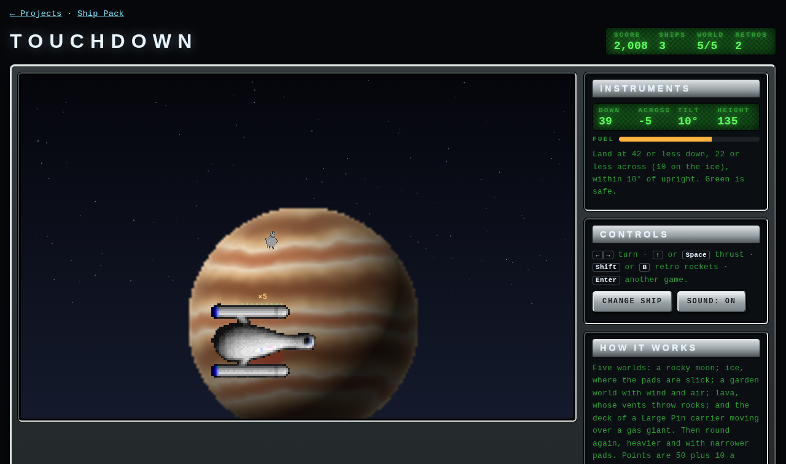

# Touchdown

Lunar Lander with the pack's ships. Bring your hull down on a pad, upright and
slow, on five worlds. Then go round again, heavier, with narrower pads. Thrust
runs along the sprite frame shown, as in Rockfall.

| | |
| --- | --- |
| Technique | Canvas 2D, a fixed 60 Hz step, ground by midpoint displacement with flat pads pressed into it, the carrier's deck read from the Large Pin's sprite alpha (frame 9, the top edge column by column) so you land on the hull's real outline |
| Your lander | any design but the Large Pin, which is the carrier: Gryphon, Defender, Trident, Citrus, Advisor, Necromancer, Yodacon, Callisto, Tomaquad, Dart or the 1998 Yodacon. Thrust from `Accel`, turn from `Maneuver`, fuel from `Fuel`. The Dart and the 1998 Yodacon are the hard ones |
| The worlds | a rocky moon; an ice world with slick pads (10 across, not 22); a garden world with wind gusts (a windsock top left) and air that drags; a lava world whose vents throw burning rocks; and the deck of a Large Pin carrier sliding over a gas giant, worth ×5. The planets are the pack's own pictures |
| A landing | at most 42 down and 22 across (relative to the carrier on the deck), within 10° of upright, both feet on a pad. Points: 50 plus 10 a second of fuel left, times the pad (×1 to ×5) and the tour |

**Retro rockets** (<kbd>Shift</kbd> or <kbd>B</kbd>, or RETRO on a touch
screen): twice a world, kill three quarters of your speed in under half a
second. For the moment you have come in too fast.

Keys: <kbd>←</kbd> <kbd>→</kbd> turn, <kbd>↑</kbd> or <kbd>Space</kbd> thrust,
<kbd>Shift</kbd> retro, <kbd>Enter</kbd> another game. Three ships. The best
score for each hull is kept in `localStorage`.

Play-test: `node tools/drive_page.mjs "<url>/projects/touchdown/?hull=0" projects/touchdown/playtest/autopilot.js`
picks the pad worth most for the distance, holds height until over it, then
comes down at a rate that shrinks with height, pointing the thrust along the
acceleration it wants (gravity and wind included). With the Gryphon it made
ten landings, two full tours, losing two ships to lava bombs. The Trident and
the Callisto made six of six; the Dart managed three.

Ships from the Yodacon Ship Pack by Paul Richeson (ConEx, 1997; ConEx Override,
1998), GPL-2.0-or-later — https://github.com/yodacon/yodacon-ship-pack
