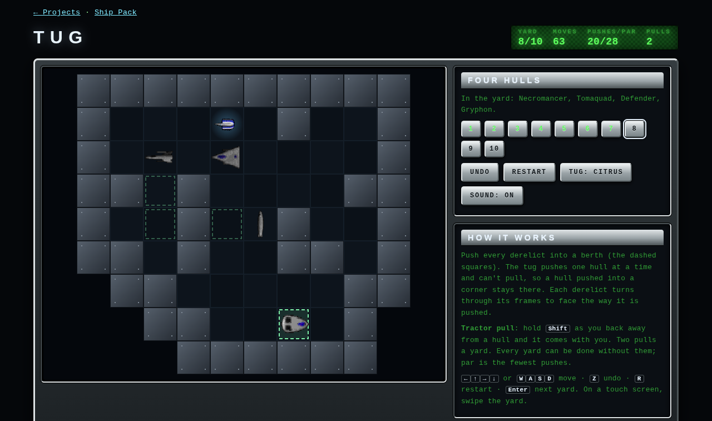

# Tug

Sokoban in a salvage yard. Push every derelict into a repair berth. The tug
pushes one hull at a time and can't pull, so a hull pushed into a corner stays
there. Each derelict turns through its sprite frames to face the way it is
pushed, the short way round.

| | |
| --- | --- |
| Technique | Canvas 2D, turn-based moves drawn sliding over 0.11 s, a history stack for undo, bulkheads drawn only where they touch the yard |
| The yards | ten, generated offline by `playtest/generate.py`: random walls and berths, then a breadth-first search backwards (pulls) from the solved yard; the state farthest from it becomes the start, so each yard is solvable without a pull and its par, the fewest pushes, is known. From 7 pushes to 32, two derelicts to four |
| The derelicts | handed out round the yards so that every design turns up: Dart, Necromancer, Tomaquad, Defender, Gryphon, Trident, Yodacon, Callisto, Large Pin and the 1998 Yodacon |
| The tug | konex's Citrus or Advisor |

**Tractor pull** (hold <kbd>Shift</kbd> as you move, or PULL then a direction
on a touch screen): back away from a hull and it comes with you. Two pulls a
yard, for getting a hull out of a corner. Undo is free and unlimited, and
gives a pull back.

Keys: arrows or <kbd>W</kbd> <kbd>A</kbd> <kbd>S</kbd> <kbd>D</kbd> move,
<kbd>Z</kbd> undo, <kbd>R</kbd> restart, <kbd>Enter</kbd> next yard. Yards
open one at a time; your fewest pushes for each is kept in `localStorage`.
`?all` opens every yard.

Play-test: `node tools/drive_page.mjs "<url>/projects/tug/?all" projects/tug/playtest/solver.js`
solves every yard with a breadth-first search over pushes and plays the
solution through the game's own `move()`: all ten are solved at par. It then
pulls a hull and undoes everything, and checks the yard is as it started.

Ships from the Yodacon Ship Pack by Paul Richeson (ConEx, 1997; ConEx Override,
1998), GPL-2.0-or-later — https://github.com/yodacon/yodacon-ship-pack
