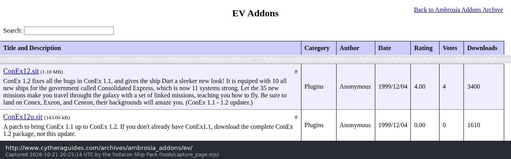
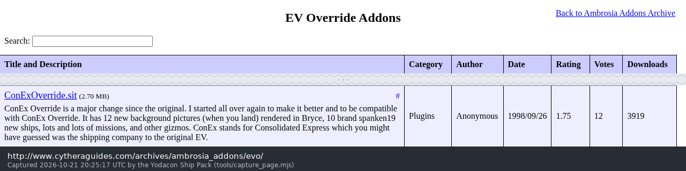

# The originals, rehosted

Paul Richeson's two Escape Velocity plugins as they were published, byte for
byte, so they stay downloadable after the sites that carried them are gone.
Everything else in this pack is built from these files and nothing else.

| File | What it is | SHA-256 |
| --- | --- | --- |
| [`ev/792_ConEx12.sit.hqx`](ev/792_ConEx12.sit.hqx) | ConEx 1.2 for *Escape Velocity*, BinHex 4.0 | `ded5fc0c7d9412ae174bd28a690d683fef65a571b809731ab626a31589aa4627` |
| [`ev/ConEx 1.2.sit`](<ev/ConEx 1.2.sit>) | the same, unwrapped: StuffIt 5, Arsenic | `593d8c50e11cc3d405e06eb3736671afeba76c82527bbd13fd21748ca8032d58` |
| [`ev/793_ConEx12u.sit.hqx`](ev/793_ConEx12u.sit.hqx) | the ConEx 1.1 → 1.2 updater (two ResCompare patch apps) | `733635f8be2db77e5c6d5c3c0ead8549ea5e3199d01fdfa19fcf7690c5982940` |
| [`ev/ConEx 1.2 Patches.sit.1`](<ev/ConEx 1.2 Patches.sit.1>) | the updater, unwrapped (its BinHex name, kept as is) | `84d1f09a2ede7583bb7100105e37dce71f7e5e9f1c2273554d28e857ca8667e1` |
| [`evo/2437_ConExOverride.sit.hqx`](evo/2437_ConExOverride.sit.hqx) | ConEx Override 1.0 for *EV Override*, BinHex 4.0 | `6546a9820d904abcaae0bbe742b4d7fd2fbab4a6ab318088faf460b325e4b252` |
| [`evo/ConEx Override1.0.0.sit`](<evo/ConEx Override1.0.0.sit>) | the same, unwrapped: classic StuffIt, method 13 | `177c435089ba16228ed757a9f2b3d545d003d9882fb47532f262bac34e179bd1` |
| `ev/ConEx12.sit.txt`, `ev/ConEx12u.sit.txt` | the download pages' descriptions, as an earlier archive kept them | |

To open them on a modern machine, use `python3 tools/extract.py <file> <out-dir>`
from this pack (pure Python, every checksum verified), or The Unarchiver.

## Where they were published

[`catalogue.json`](catalogue.json) has every entry below with its file links and
digests. The catalogue rows, as Cythera Guides lists them:

| Title and Description | Category | Author | Date | Rating | Votes | Downloads |
| --- | --- | --- | --- | ---: | ---: | ---: |
| **ConEx12.sit** (1.10 MB) — ConEx 1.2 fixes all the bugs in ConEx 1.1, and gives the ship Dart a sleeker new look! It is equiped with 10 all new ships for the government called Consolidated Express, which is now 11 systems strong. Let the 35 new missions make you travel throught the galaxy with a set of linked missions, teaching you how to fly. Be sure to land on Conex, Exeon, and Cenron, their backgrounds will amaze you. (ConEx 1.1 - 1.2 updater.) | Plugins | Anonymous | 1999/12/04 | 4.00 | 4 | 3400 |
| **ConEx12u.sit** (143.00 kB) — A patch to bring ConEx 1.1 up to ConEx 1.2. If you don't already have ConEx1.1, download the complete ConEx 1.2 package, not this update. | Plugins | Anonymous | 1999/12/04 | 0.00 | 0 | 1610 |
| **ConExOverride.sit** (2.70 MB) — ConEx Override is a major change since the original. I started all over again to make it better and to be compatible with ConEx Override. It has 12 new background pictures (when you land) rendered in Bryce, 10 brand spanken19 new ships, lots and lots of missions, and other gizmos. ConEx stands for Consolidated Express which you might have guessed was the shipping company to the original EV. | Plugins | Anonymous | 1998/09/26 | 1.75 | 12 | 3919 |

Text as published, spelling included. The dates are the catalogue's, not the
releases': the files inside are dated 9–28 November 1997 (ConEx 1.2) and
26 May – 10 July 1998 (ConEx Override 1.0).

### Back-references

- **Cythera Guides**, mirror of Ambrosia's add-on archive:
  [EV add-ons](http://www.cytheraguides.com/archives/ambrosia_addons/ev/) ·
  [EV Override add-ons](http://www.cytheraguides.com/archives/ambrosia_addons/evo/) ·
  files: [792_ConEx12.sit.hqx](http://www.cytheraguides.com/archives/ambrosia_addons/ev/Plugins/792_ConEx12.sit.hqx),
  [793_ConEx12u.sit.hqx](http://www.cytheraguides.com/archives/ambrosia_addons/ev/Plugins/793_ConEx12u.sit.hqx),
  [2437_ConExOverride.sit.hqx](http://www.cytheraguides.com/archives/ambrosia_addons/evo/Plugins/2437_ConExOverride.sit.hqx).
  The number before each file name is Ambrosia's own add-on ID.
- **Ambrosia Software**, where the plugins were first distributed. Ambrosia's
  servers are offline; these are the Wayback Machine's copies:
  - Ambrosia's own ConEx 1.2 file, `ambrosiasw.com/assets/files/addons/ev/ConEx12.sit.hqx`,
    [archived 13 April 2013](https://web.archive.org/web/20130413003920/http://www.ambrosiasw.com/assets/files/addons/ev/ConEx12.sit.hqx).
    The archive's SHA-1 for it, `ZDTUBHW2GS3P3HGSW2S3BQQFL7K6Z56O`, is this
    copy's: the file rehosted here is byte-identical to the one Ambrosia served.
    It was reached through `download.php?addon=792`.
  - [The EV add-on library, 31 May 2000](https://web.archive.org/web/20000531134400/http://www.ambrosiasw.com/games/ev/addons.html)
    ([picture](screenshots/ambrosia-ev-addons-2000.png))
  - [The EV Override add-on library, 26 October 2002](https://web.archive.org/web/20021026175510/http://www.ambrosiasw.com/games/evo/addons)
  - [Ambrosia's FTP server, 5 December 1998](https://web.archive.org/web/19981205225923/http://ftp.ambrosiasw.com/)
    ([picture](screenshots/ambrosia-ftp-1998.png))

  ConEx's own entries in the add-on library were not archived, and neither was
  Ambrosia's copy of the updater or of ConEx Override.

## ConEx's home page

The ConEx 1.2 readme gives `http://www.geocities.com/SiliconValley/Way/9298`,
and both readmes give `conex@geocities.com`. The page itself is lost: the Wayback Machine only ever
caught a redirect (17 January 1999) and then a 404 (3 March 2004), and the
OoCities rescue of GeoCities has no copy. See [TIMELINE.md](../TIMELINE.md).

## The screenshots

[`screenshots/`](screenshots/) holds dated pictures of those pages, taken with
`tools/capture_page.mjs` (headless Chromium over the DevTools protocol: it
measures the catalogue row on the live page and photographs exactly that
rectangle) and stamped by `tools/stamp_capture.py` with the URL and the UTC
time of capture. A torn edge marks where rows between the header and the
entry were left out.

| Picture | Page | Captured (UTC) |
| --- | --- | --- |
| `cythera-ev-conex12.png` | cytheraguides.com, EV add-ons | 2026-10-21 20:25:14 |
| `cythera-evo-conexoverride.png` | cytheraguides.com, EV Override add-ons | 2026-10-21 20:25:17 |
| `ambrosia-ev-addons-2000.png` | ambrosiasw.com EV add-ons, Wayback 2000-05-31 | 2026-10-21 20:25:41 |
| `ambrosia-ftp-1998.png` | ftp.ambrosiasw.com, Wayback 1998-12-05 | 2026-10-21 20:25:44 |
| `geocities-2004-404.png` | geocities.com/SiliconValley/Way/9298/, Wayback 2004-03-03 | 2026-10-21 20:53:13 |
| `geocities-oocities-not-archived.png` | oocities.org, the GeoCities rescue mirror | 2026-10-21 20:52:21 |

## Who owns what

ConEx and ConEx Override are Paul Richeson's work ("ConEx is property of Paul
Richeson … Creator: Paul Richeson", from both readmes). The 1997–98 readmes
asked that modified versions not be distributed and that hosts e-mail him
first; as the author he has replaced those terms with GPL-2.0-or-later for
everything in this pack (see `LICENSE`).

*Escape Velocity* and *EV Override* are Ambrosia Software's. The plugins never
contained Ambrosia's game art: hulls that ConEx borrowed from the game (ConEx
1.2's ships 130–165) point at sprites inside *Escape Velocity* itself, which
are not in these archives. The one Ambrosia item the plugins do carry, the
Ambrosia logo (PICT 8100), is left out of the pack's decoded pictures. It is
still inside the original archives above, which are kept byte for byte, and
the pack's licence does not cover it.
